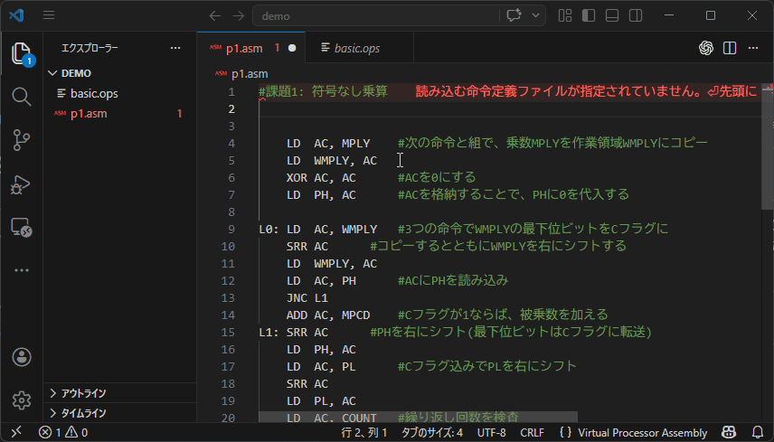
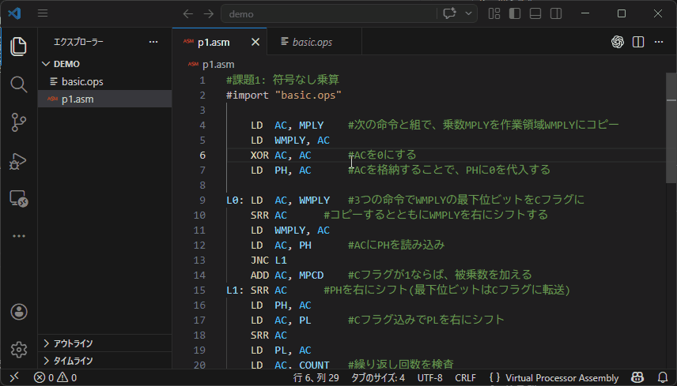
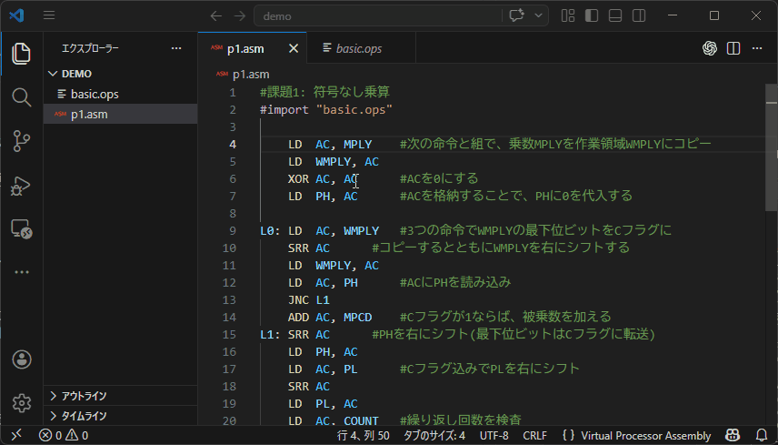

# マイクロプロセッサ

アセンブリファイルと命令定義ファイルの編集をサポートします。

## はじめに
---

- VSCodeの基本操作 : [VSCodeの使い方(公式サイト)](https://vscode.dokyumento.jp/docs/getstarted/getting-started)
- **おすすめ拡張機能** : [Error Lens](https://marketplace.visualstudio.com/items?itemName=usernamehw.errorlens)  
→エラーをエディタ上に直接表示できるため、この拡張機能と併用することで視認性が向上します。

## 使用方法
---
アセンブリファイル（.asm）内で、命令定義ファイル（.ops）を次のように読み込んでください。  
`#import "xxx.ops"`  
命令定義ファイル(.ops)は **絶対パス**または**相対パス**で指定できます。 ([パスとは(外部サイト)](https://tegasuki.com/absolute-relative-path/))

## 機能一覧
---
- [ハイライト表示](#ハイライト表示)
- [定義ジャンプ](#定義ジャンプ)
- [ホバー表示](#ホバー表示)
- [エラー検出](#エラー検出)

## 機能詳細
---
### ・ハイライト表示
要素ごとに単語の色付けを行います。

### ・定義ジャンプ
命令ニーモニック、ラベルにカーソルを合わせて「**Ctrl + 左クリック**」で定義箇所にジャンプします。

### ・ホバー表示
特定の単語にカーソルを合わせると、その単語の説明がホバー表示されます。

- レジスタなど
- 命令ニーモニック（上のコメントを表示）  
- ラベル（定義行のコメントを表示）  

### ・エラー検出
単純なエラーを検出し、エラーまたは警告表示を行います。
  - 未定義命令の使用
  - 未定義ラベルの使用
  - オペコードの重複
  - ラベルに命令ニーモニック名やレジスタ名の使用

