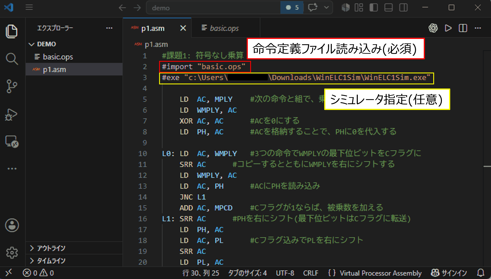
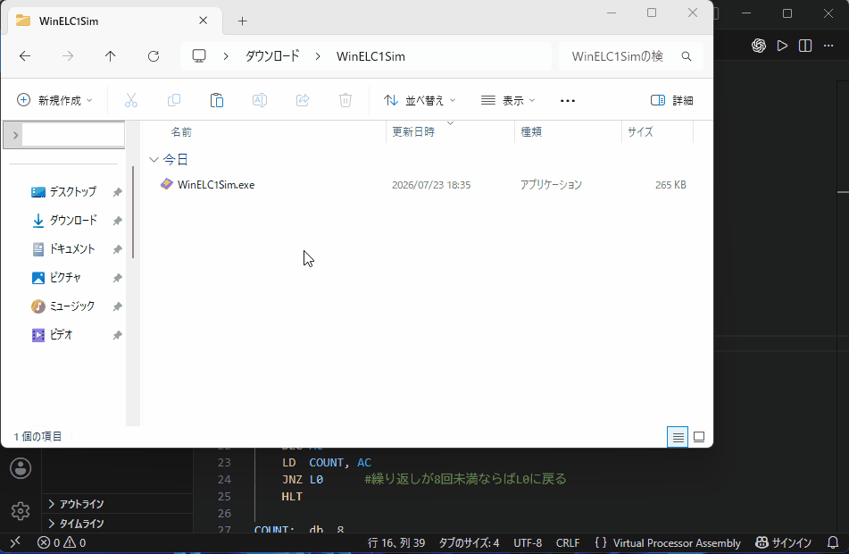
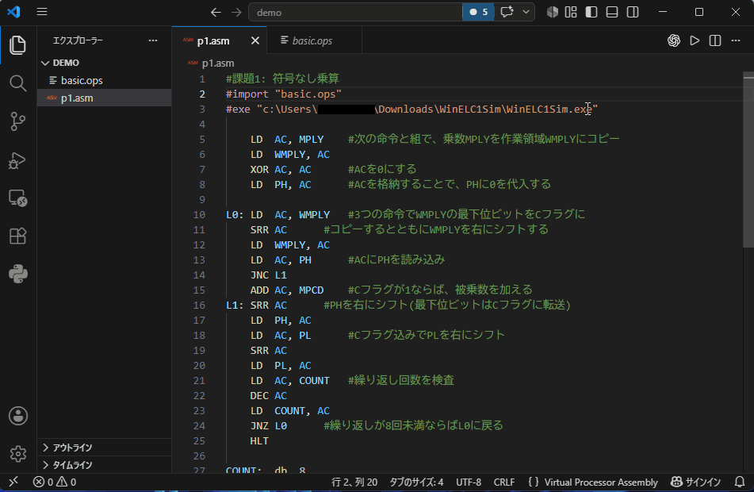

# マイクロプロセッサ

アセンブリファイルと命令定義ファイルの編集をサポートします。(埼玉大学 電気電子物理工学実験Ⅲ「マイクロプロセッサ」向け)  
[実験ページはこちら](https://elc.eeap.saitama-u.ac.jp/ITO/Ex3/)

## 目次
---
- [はじめに](#はじめに)
- [使用方法](#使用方法)
- [機能一覧](#機能一覧)

## はじめに
---

- VSCodeの基本操作 : [VSCodeの使い方(公式サイト)](https://vscode.dokyumento.jp/docs/getstarted/getting-started)  
→VSCodeは、プログラムを書くための機能を豊富に備えたコードエディタです。
- **おすすめ拡張機能** : Error Lens (拡張機能ビューで検索してインストール)  
→エラーをエディタ上に直接表示できるため、この拡張機能と併用することで視認性が向上します。

## 使用方法
---
### ・命令定義ファイル読み込み(**必須**)
アセンブリファイル（.asm）内で、命令定義ファイル（.ops）を次のように読み込んでください。  
`#import "xxx/xxx.ops"`  
命令定義ファイル(.ops)は **絶対パス**または**相対パス**で指定できます。 ([パスとは(外部サイト)](https://tegasuki.com/absolute-relative-path/)) ([絶対パスの取得方法](#絶対パスの取得方法))

### ・シミュレータの指定(**任意**)
アセンブリファイル（.asm）内で、使用するシミュレータ(WinELC1Sim.exe)を次のように指定してください。  
`#exe "xxx/WinELC1Sim.exe"`   
シミュレータも同様に、絶対パスまたは相対パスで指定できます。(**絶対パス**がおすすめ) ([絶対パスの取得方法](#絶対パスの取得方法))

### ※絶対パスの取得方法
エクスプローラーで該当ファイルをコピーすることで、絶対パスを取得できます。

## 機能一覧
---
- [シミュレータ起動](#シミュレータ起動)
- [定義ジャンプ](#定義ジャンプ)
- [ホバー表示](#ホバー表示)
- [ハイライト表示](#ハイライト表示)
- [エラー検出](#エラー検出)

## 機能詳細
---

### ・シミュレータ起動
画面右上の実行ボタンを押すことでシミュレータ(WinELC1Sim.exe)を起動し、ファイル読み込みを自動で行います。  
(※[シミュレータの指定](#シミュレータの指定任意)をする必要があります。)  
(※シミュレータの初回起動は手動で行ってください。)  
(※ボタン押下～ファイル読み込み完了まで**キー操作・クリック**をしないでください。)

### ・定義ジャンプ
命令ニーモニック、ラベルにカーソルを合わせて「**Ctrl + 左クリック**」で定義箇所にジャンプします。

### ・ホバー表示
特定の単語にカーソルを合わせると、その単語の説明がホバー表示されます。

- レジスタなど
- 命令ニーモニック（上のコメントを表示）  
- ラベル（定義行のコメントを表示）  

### ・ハイライト表示
要素ごとに単語の色付けを行います。

### ・エラー検出
単純なエラーを検出し、エラーまたは警告表示を行います。
  - 未定義命令の使用
  - 未定義ラベルの使用
  - オペコードの重複
  - ラベルに命令ニーモニック名やレジスタ名の使用

